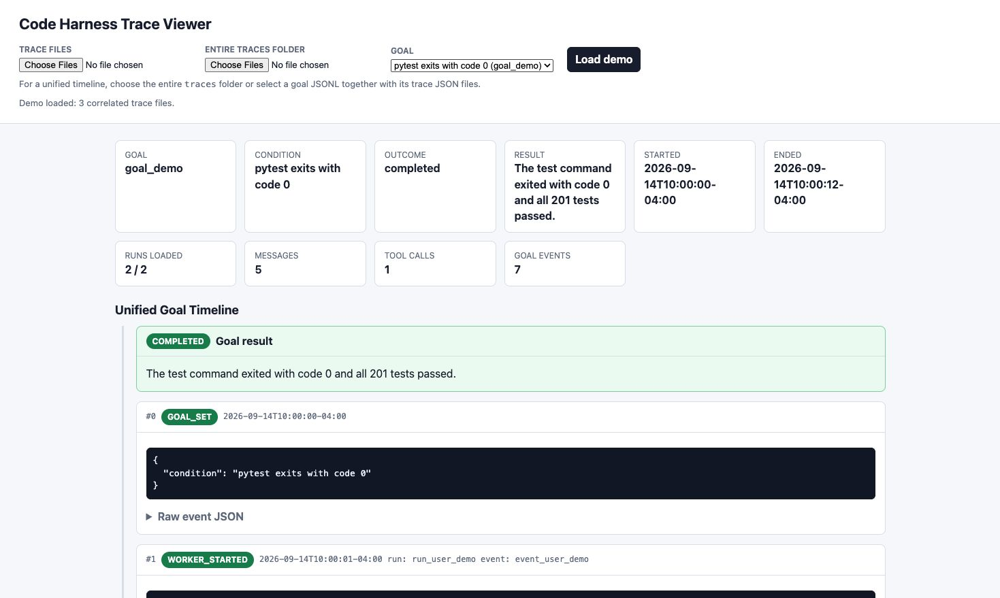
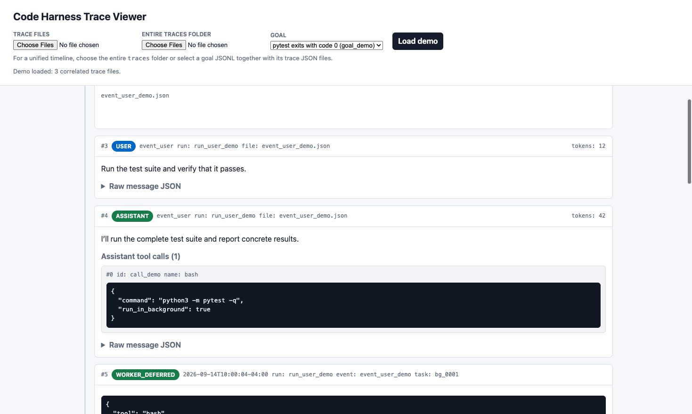
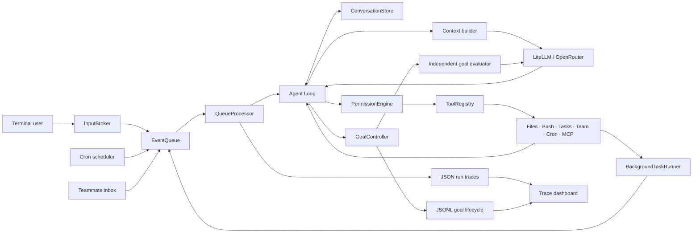

# Code Harness

A local-first, terminal-based coding-agent harness written in Python. It combines an event-driven agent loop, typed tools, workspace permissions, background execution, goal evaluation, teammate coordination, scheduled prompts, and inspectable JSON traces.

> [!NOTE]
> This is an experimental developer project. Review `settings.json` and the configured model before using it on an important repository.



## Highlights

- **Interactive coding agent** powered through LiteLLM and OpenRouter.
- **Typed tool system** with Pydantic validation and automatic tool discovery.
- **Workspace safety** with allow, ask, and deny rules plus project-root path enforcement.
- **Goal mode** that evaluates concrete completion conditions and automatically continues incomplete work.
- **Background execution** for slow commands such as tests, builds, and installs.
- **Event queue** shared by terminal input, background completions, cron jobs, and teammate messages.
- **Teammates and subagents** with separate context, message passing, plan approval, task ownership, and Git worktrees.
- **MCP tools over stdio** discovered from real subprocess servers through the 2025-11-25 handshake and registered alongside local tools.
- **Trace dashboard** that correlates user runs, background runs, tool calls, and goal evaluations into one timeline.

## Quick start

### Requirements

- Python 3.12 or newer
- An [OpenRouter](https://openrouter.ai/) API key
- Git, if you want to use managed worktrees

### Installation

```bash
# Clone the repository using the HTTPS or SSH URL shown by GitHub, then:
cd code_harness

python3 -m venv .venv
source .venv/bin/activate
python3 -m pip install -e .

cp env.example .env
```

Edit `.env` and add your OpenRouter key:

```dotenv
OPENROUTER_API_KEY=your_openrouter_api_key
MODEL_ID=openrouter/provider/model-name
```

Start the harness for the current repository:

```bash
code-harness --workspace .
```

The default runtime directory is `<workspace>/.code-harness/`. Use
`--state-dir` or `--settings` to override either location. Type `exit` or
`quit` to stop the application.

## Short demo

Set a verifiable goal directly from the terminal:

```text
> /goal python3 -m pytest exits with code 0
Goal set: python3 -m pytest exits with code 0

# The agent runs the tests. Slow commands can continue in the background.
# When the result arrives, the independent evaluator checks the evidence.

> /goal
Goal: python3 -m pytest exits with code 0
Status: completed
Evaluations: 1
Latest reason: The test command exited with code 0 and all tests passed.
```

Regular prompts do not require goal mode:

```text
> Find the bug in examples/calculator.py, fix it, and run its tests.
```

Goal commands:

| Command | Purpose |
| --- | --- |
| `/goal <condition>` | Set or replace a goal and begin work |
| `/goal` or `/goal status` | Show the active or most recent goal |
| `/goal clear` | Clear the active goal |
| `/goal help` | Show command help |

## Trace dashboard

Open `trace_viewer.html` in a browser. You can then:

1. Click **Load demo** to explore a sanitized example immediately.
2. Choose one JSON or JSONL trace for a single-run view.
3. Choose multiple related files for correlation.
4. Choose the entire `.code-harness/traces/` folder for a unified goal timeline.

The dashboard joins files through `goal_id`, `conversation_id`, `run_id`, `event_id`, and `background_task_id`. It shows the goal outcome, run boundaries, messages, token estimates, tool arguments, background results, nested LLM calls, and evaluator decisions. Missing referenced runs are reported explicitly.



Trace files are local runtime artifacts and are ignored by Git. They can contain prompts, model responses, tool arguments, and command output, so inspect them before sharing.

## Architecture



### Runtime flow

1. `main.py` parses CLI options and `core/application.py` owns runtime assembly and shutdown.
2. Terminal input becomes an event rather than invoking the model directly.
3. `QueueProcessor` serializes events into the agent loop and records a trace for each run.
4. The loop builds model context, calls LiteLLM, validates tool calls, applies permissions, and records tool results.
5. Slow operations can return immediately and publish a background-completion event later.
6. When goal mode is active, an independent evaluator checks the accumulated work record before allowing the run to stop.
7. The trace dashboard reconstructs an end-to-end timeline across run and goal files.

### Main modules

| Path | Responsibility |
| --- | --- |
| `main.py` | Small command-line entry point |
| `core/application.py` | Runtime dependency assembly and managed shutdown |
| `core/loop.py` | Agent/tool loop, stop handling, and background coordination |
| `core/tool_execution.py` | Permission-aware tool-call execution |
| `core/subagents.py` | Bounded one-shot subagent execution |
| `core/permissions.py` | Permission rules, workspace boundaries, and command review |
| `core/background_task.py` | Threaded execution and completion notifications |
| `core/tracing.py` | Run traces, goal events, correlation IDs, and redaction |
| `memory/` | Conversation records, context selection, summaries, and compaction |
| `events/` | FIFO event models, persistence, and queue processing |
| `goals/` | Goal commands, state, evidence context, evaluation, and persistence models |
| `tools/` | Local tools, validation, task management, cron, team, and worktrees |
| `team/` | Teammate mailboxes and typed coordination protocols |
| `mcp/` | MCP client abstraction and dynamic tool registration |
| `cron_scheduler/` | One-shot and recurring scheduled agent events |
| `trace_viewer.html` | Standalone correlated trace dashboard |
| `tests/` | Unit and integration-style test suite |

## Configuration

### Environment variables

| Variable | Required | Description |
| --- | --- | --- |
| `OPENROUTER_API_KEY` | Yes | API key used by LiteLLM for OpenRouter calls |
| `MODEL_ID` | Yes | Model used by the lead agent, subagents, command review, and LLM summarizer |
| `WORKTREE_REPOSITORY_ROOT` | No | Repository managed by worktree tools; defaults to this repository |
| `GOAL_EVALUATOR_MODEL_ID` | No | Overrides the worker model for independent goal evaluation |

When `GOAL_EVALUATOR_MODEL_ID` is omitted, goal evaluation uses `MODEL_ID`.

### Permissions and MCP

`settings.json` controls:

- `permissions.allow`: operations that can run without confirmation.
- `permissions.ask`: operations that require approval.
- `permissions.deny`: operations that must not run.
- `mcp.servers`: bundled mock names or named stdio server definitions connected during startup.

Deny rules take precedence. Bash commands are also checked for dangerous patterns, denied paths, workspace escapes, and ambiguous operations. The bundled `docs` and `deploy` names are deterministic test/demo servers.

For a real MCP subprocess, use a named object. Reference credentials through
environment variables instead of writing values into `settings.json`:

```json
{
  "mcp": {
    "servers": {
      "filesystem": {
        "transport": "stdio",
        "command": "npx",
        "args": ["-y", "@modelcontextprotocol/server-filesystem", "."],
        "env": {"SERVICE_TOKEN": "${SERVICE_TOKEN}"}
      }
    }
  }
}
```

## Testing

Install the development toolchain once:

```bash
python3 -m pip install -e ".[dev]"
python3 -m pre_commit install
```

Format and automatically fix safe lint findings:

```bash
make format
```

Run the same non-mutating quality gate used in CI:

```bash
make check
```

Run the complete suite from the repository root:

```bash
python3 -m pytest
```

Run one test module:

```bash
python3 -m pytest tests/test_goal_controller.py -q
```

Latest verified result on Python 3.12:

```text
208 passed, 6 subtests passed
```

The suite covers the agent loop, permissions, workspace isolation, application lifecycle, background tasks, event processing, goal evaluation, trace persistence, real MCP stdio transport, teammate protocols, cron scheduling, and worktree behavior. External model calls are mocked in tests. CI enforces at least 70% branch-aware coverage.

## Runtime data

The harness creates local state while it runs:

| Path | Contents |
| --- | --- |
| `.code-harness/traces/` | Per-run JSON traces and per-goal JSONL timelines |
| `.code-harness/.mailboxes/` | Teammate messages |
| `.code-harness/.tasks/` | Task state |
| `.code-harness/.worktrees/` | Managed worktree metadata and directories |
| `.code-harness/.scheduled_tasks.json` | Durable scheduled prompts |
| `.code-harness/.cron_events.json` | Scheduler event state |

Secrets belong in `.env`, which is ignored by Git. Never commit API keys or publish raw traces without reviewing their contents.
The GitHub Actions quality workflow scans the complete commit history with
Gitleaks and rejects detected credentials.

## Project status

This repository is suitable for local development and experimentation. Current limitations include process-local conversation memory, file-based trace storage, legacy-handshake stdio MCP transport (no 2026-07-28 negotiation yet), and no multi-user authentication.

## Contributing

1. Create a focused branch.
2. Add or update tests for behavioral changes.
3. Run `make check`.
4. Describe permission or configuration changes clearly in the pull request.

Use Python 3.12-compatible syntax, four-space indentation, type hints for public interfaces, and the existing `test_*.py` naming convention.

## License

Released under the [MIT License](LICENSE).
